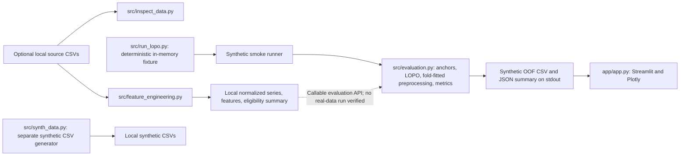

# Competition Submission Notes

This document describes the current repository state, not completed real-data research. The dashboard and smoke runner use synthetic data only.

## Architecture



The dataset inspector and feature-engineering command operate on files explicitly supplied by the user. The current LOPO runner does not discover or load these files; it constructs an in-memory synthetic fixture. The dashboard calls that runner and reads only its synthetic output.

## Presentation Outline

1. **Problem and scope:** Predict a future Libre threshold event as an exploratory software objective; make no clinical utility claim.
2. **Endpoint and data flow:** Libre >180 mg/dL in `(t, t+120 minutes]`; strict threshold, coverage rules, and separation of raw, processed, and synthetic paths.
3. **Evaluation design:** Patient-relative 10-minute anchors, one held-out participant per LOPO fold, training-fold preprocessing, fixed 0.5 cutoff, and training-majority baseline.
4. **Working prototype:** Show the synthetic-only dashboard, OOF explorer, ROC/PR and reliability diagnostics, event comparison, and synthetic timeline.
5. **Evidence gaps:** Present no real-data score until permissions, source-signal interpretation, execution evidence, and independent review are complete.

Do not add results, participant counts, citations, awards, or challenge requirements unless supported by the exact source and recorded run evidence.

## Demo Script

From the repository root in PowerShell:

```powershell
python -m venv .venv
.\.venv\Scripts\Activate.ps1
python -m pip install -r requirements.txt
python -m pytest -p no:cacheprovider tests/ -q
python -m src.run_lopo --smoke-test --output-dir app/synthetic_demo
python -m streamlit run app/app.py
```

In the app, keep the synthetic disclaimer visible, show Overview and its class prevalence/baseline comparison, filter the OOF Explorer by participant/fold, inspect the probability and reliability diagnostics, then show the synthetic glucose timeline. State that every plotted value and score is synthetic and demonstrates software behavior only. Do not open or display local real-data files during this demo unless their rights and handling have been verified separately.

## Submission Checklist

- [x] Synthetic-only dashboard and deterministic LOPO smoke path are implemented.
- [x] Target, feature timing, patient-wise folds, and fold-fitted preprocessing have regression coverage.
- [x] Requirements, setup, test, and launch commands are documented.
- [x] A source-editable architecture diagram, presentation outline, demo script, and evidence checklist are included.
- [ ] Confirm the current dataset terms, attribution, and the competition's permitted use with the rights holder/source documentation.
- [ ] Verify that the competition rules permit the intended dataset and any derived artifacts to be submitted or shown.
- [ ] Execute a reproducible real-data run only after the permissions and input provenance are confirmed; retain a manifest, code revision, archive hash, environment, and protocol settings.
- [ ] Independently inspect source signal cadence/interpolation and validate target eligibility against source documentation; do not treat interpolated rows as verified device measurements.
- [ ] Review per-patient eligibility/class counts, missingness, baseline comparisons, uncertainty, and failure cases before discussing real-data performance.
- [ ] Obtain a scientific/clinical review appropriate to the competition; no clinical validation or readiness is established here.
- [ ] Replace this outline with the actual required deck/report only after the official competition deliverables and rubric are confirmed.
- [ ] Decide whether a license is appropriate after reviewing project ownership and dataset restrictions; none is added by this work.

## Ranked Blockers and Evidence Needed

1. **Data permissions and competition terms:** Current permitted use, redistribution, derived output, attribution, and deadline/rubric requirements need confirmation from authoritative documents. The official PhysioNet page could not be independently retrieved during this review; README's license note is not a substitute for current legal verification.
2. **Real-data scientific evidence:** No real-data pipeline run or model result was produced or reviewed in this work. Required evidence includes the exact source archive/hash, code revision, environment, participant-level eligibility, fold assignments, baseline results, OOF predictions, and metric definitions.
3. **Signal semantics:** Source acquisition cadence versus upstream interpolation remains unresolved. Obtain source documentation and validate temporal assumptions before interpreting windows or event exposure as device-measured time.
4. **External validation and calibration:** Synthetic reliability plots and Brier scores are software diagnostics, not real-data calibration evidence. Any real-data calibration procedure, operating point, and uncertainty plan must be pre-specified and evaluated without held-out-patient leakage.
5. **Reproducible submission package:** `requirements.txt` is not a fully locked environment, the run-manifest helper is not wired into the smoke command, and no final deck or real-data report exists. Record versions and hashes for any permitted real-data evaluation; follow the challenge's actual submission format.

## Completion Estimate

Planning estimates, not measured scores: **software prototype 75–85%** for the repository's synthetic demo and data-processing/evaluation components; **real-data scientific validation 0% complete** because no appropriately permitted real-data evaluation is evidenced; **competition submission readiness 35–45%** because the outline and prototype are present but permissions, challenge requirements, real-data evidence, and final submission materials remain outstanding. These estimates do not imply clinical readiness.
